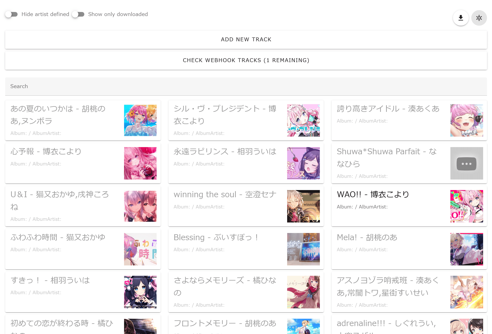
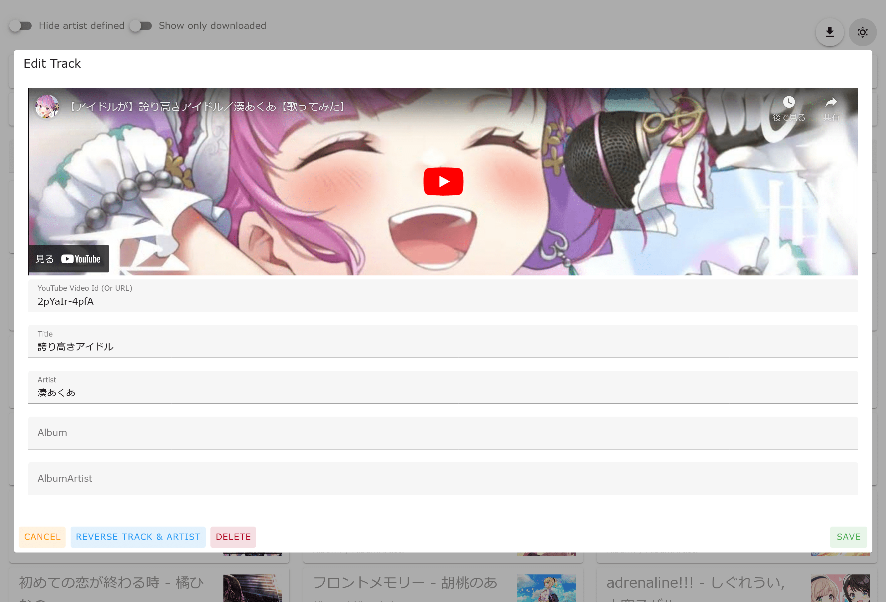
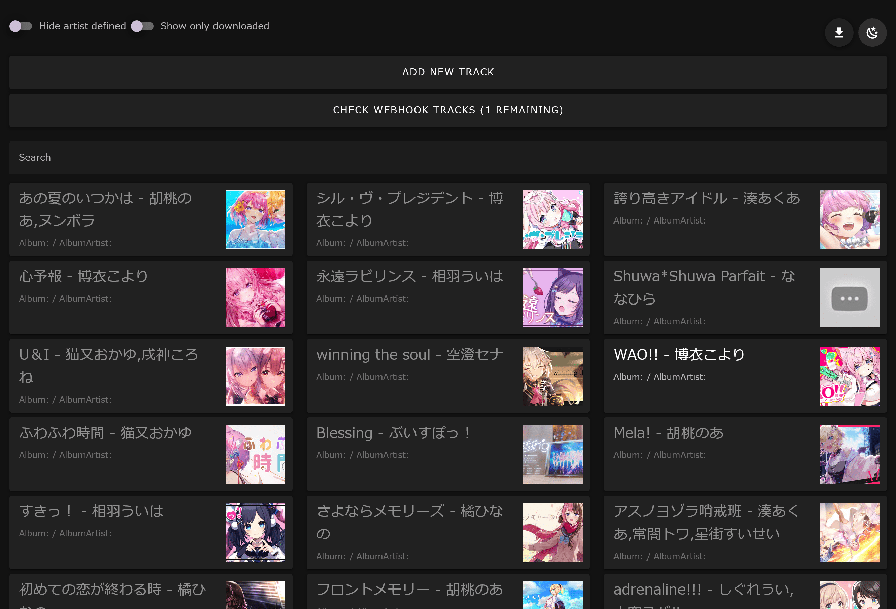
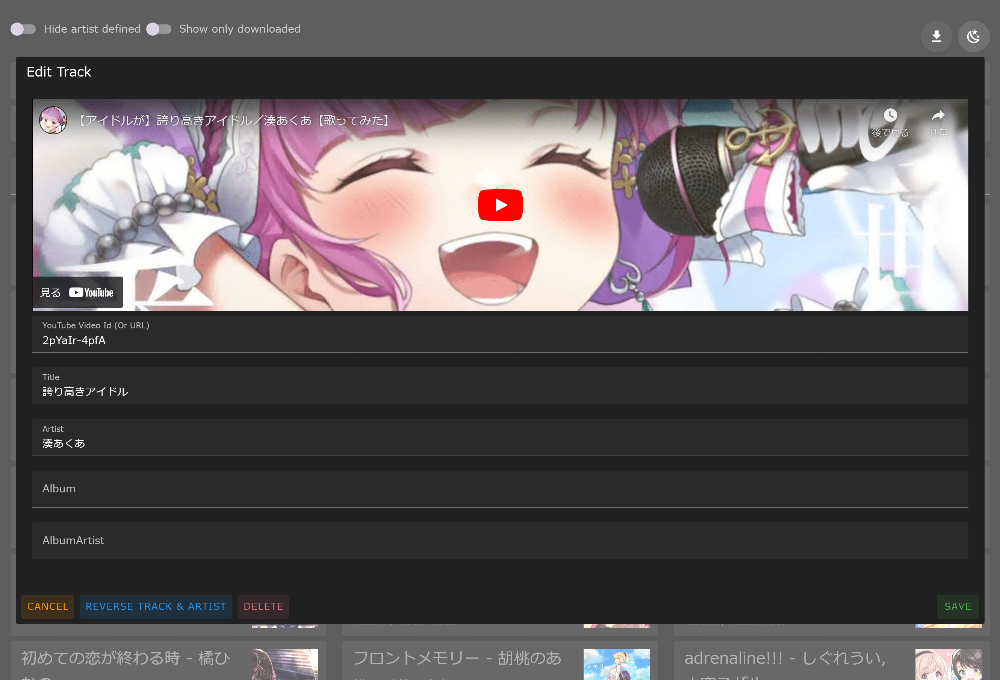

# fetch-youtube-bgm

YouTube のプレイリストの動画をダウンロードし、MP3 に変換してメタデータを付与する。

## 機能

- YouTube のプレイリスト (公開または限定公開) に追加された動画をダウンロードし、MP3 に変換して ID3 タグを付与する。
- mp3gain または ReplayGain (rgain3) で MP3 の音量を揃える。
- シンプルな Web UI で、動画に付与するタイトル・アーティスト・アルバム・アルバムアーティストを設定できる。
- ブラウザ拡張機能 Web Scrobbler の "Edited tracks" にインポートできる形式の JSON をダウンロードできる。
  - [tomacheese/auto-update-web-scrobbler](https://github.com/tomacheese/auto-update-web-scrobbler) を使うと Web Scrobbler と自動で同期できる。
- [FolderSync](https://play.google.com/store/apps/details?id=dk.tacit.android.foldersync.lite) などの Android アプリを使うと、MP3 ファイルをスマートフォンへ自動で保存できる。
- Google アカウントの認証情報は不要。
- 新しいトラックが追加されたときに Discord へ通知できる。

## スクリーンショット

### ライトモード

| 一覧画面 | トラック編集画面 |
| :-: | :-: |
|  |  |

### ダークモード

| 一覧画面 | トラック編集画面 |
| :-: | :-: |
|  |  |

## インストール

### 1. YouTube で限定公開または公開のプレイリストを作成する

[再生リストの作成と管理 - YouTube ヘルプ](https://support.google.com/youtube/answer/57792)を参照する。

作成したプレイリストの ID を控える。`PLOCwArr8ScAyyr6EtRgt1TYLsOSoLBiEk` のような文字列で、プレイリスト URL の `list` パラメーターから取得できる。

### 2. Docker Compose ファイルを作成する

任意のフォルダーに `compose.yaml` を作成し、次の内容を書く。`<` と `>` で囲んだ部分は実際の値に置き換える。

- `<Timezone>`: タイムゾーン。例: `Asia/Tokyo`
- `<ServerHost>`: fetch-youtube-bgm を動かすサーバーのホスト名または IP アドレス
- `<ViewerPort>`: viewer を公開するポート番号

```yaml
services:
  downloader:
    image: ghcr.io/tomacheese/fetch-youtube-bgm-downloader
    environment:
      - TZ=<Timezone>
      - BASE_URL=http://<ServerHost>:<ViewerPort>
      # - DETECTION_INTERVAL_SECONDS=300 # 省略可: プレイリストの新規動画を検出する間隔 (秒)。デフォルト: 300 (5 分)
      # - PIPELINE_INTERVAL_SECONDS=3600 # 省略可: ダウンロード・変換のパイプライン全体を実行する間隔 (秒)。デフォルト: 3600 (1 時間)
    volumes:
      - type: bind
        source: ./data
        target: /data
    restart: always
    init: true

  viewer:
    image: ghcr.io/tomacheese/fetch-youtube-bgm-viewer
    ports:
      - "<ViewerPort>:80"
    environment:
      - TZ=<Timezone>
      - BASE_URL=http://<ServerHost>:<ViewerPort>
    volumes:
      - type: bind
        source: ./data
        target: /data
    restart: always
    init: true
```

> [!WARNING]
> viewer には認証がない。`<ViewerPort>` に到達できる人は誰でもトラックを閲覧・編集できる。LAN 内や、アクセス制御を設定した VPN / リバースプロキシの背後など、信頼できるネットワークにだけ公開し、インターネットへ直接公開しないこと。

パイプラインの実行時は、まず各動画に対して `yt-dlp --skip-download` で軽量なメタデータの一次フィルタを行う。前回から `duration` / `filesize_approx` が変わった動画 (または出力済みの MP3 が見つからない動画) だけが、ダウンロード、音量調整、前後の無音の調整、音声指紋の比較という本処理に進む。プレイリストにほとんど変更がないときの CPU 負荷を大きく減らせる。

`downloader` は、次の環境変数も受け付ける (すべて省略可)。

- `DETECTION_INTERVAL_SECONDS`: 新規動画を検出する間隔 (秒)。デフォルトは `300`。新しい動画を検出すると、パイプラインを即座に実行する。
- `PIPELINE_INTERVAL_SECONDS`: パイプラインを定期実行する間隔 (秒)。デフォルトは `3600`。
- `RUNNER_COUNT_FOR_METADATA_CHECK`: メタデータの一次フィルタを並列実行する数。デフォルトは `5`。
- `RUNNER_COUNT_FOR_DOWNLOAD`: ダウンロードの並列実行数。デフォルトは `3`。
- `RUNNER_COUNT_FOR_PROCESSING`: 変換・タグ付けなどの処理の並列実行数。デフォルトは `3`。
- `NORMALIZE_VOLUME_APP`: 音量調整に使うアプリ。`mp3gain` (デフォルト) または `rgain3`。
- `HTTPS_PROXY` / `HTTP_PROXY`: YouTube への通信に使うプロキシ。

### 3. 設定ファイルを作成する

`data/config.json` を作成し、次の JSON を書く。`<` と `>` で囲んだ部分は実際の値に置き換える。

- `<YouTubePlaylistId>`: 控えておいたプレイリストの ID
- `<DiscordWebhookUrl>`: Discord の Webhook URL (省略可)
- `<DiscordBotToken>`: Discord の Bot トークン (省略可)
- `<DiscordChannelId>`: Discord のチャンネル ID (省略可)

```jsonc
{
  "playlistId": "<YouTubePlaylistId>",
  "discord": { // 省略可
    "webhook_url": "<DiscordWebhookUrl>"
    // Webhook の代わりに Bot トークンとチャンネル ID を使う場合
    // "token": "<DiscordBotToken>",
    // "channel_id": "<DiscordChannelId>"
  }
}
```

上の例は説明用にコメントを含めている。実際の `config.json` にコメントは書けない。

ファイル名から取り除く文字は、`filename.sanitizeChars` (文字列の配列) で変更できる。デフォルトは `/` `\` `?` `%` `*` `:` `|` `"` `<` `>`。

### 4. 起動する

次のコマンドを実行する。

```shell
docker compose up -d
```

## ライセンス

このプロジェクトのライセンスは [MIT License](LICENSE) である。
